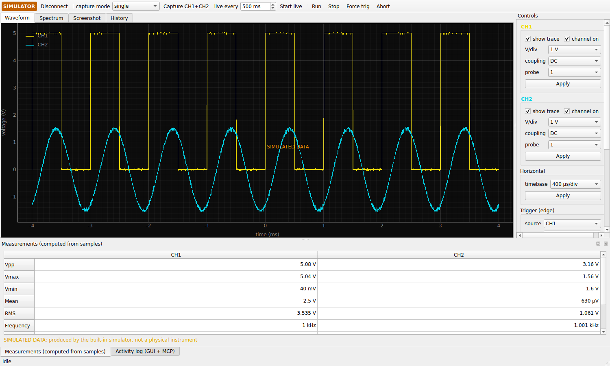

# hantek-mcp — an AI-controllable Hantek DSO5102P

[](https://github.com/Kyleidge/DSO5102P-Python/actions/workflows/ci.yml)

Python library, **Model Context Protocol (MCP) server** and **desktop GUI** that turn
the Hantek DSO5102P (2 channels, 100 MHz, 1 GS/s) into a numerical waveform
acquisition instrument an AI agent can operate: configure channels, timebase
and trigger, acquire real sample records, measure, analyse and export —
with every result stating whether it is simulated and how trustworthy its
scaling is.

Fork of [titos-carrasco/DSO5102P-Python](https://github.com/titos-carrasco/DSO5102P-Python)
by Roberto Carrasco (MIT). The original API is kept as a compatibility facade in
[`legacy/`](legacy/README.md).



> [!IMPORTANT]
> **Hardware status:** everything is implemented and tested against a
> protocol-level simulator and documented protocol data. It has **not yet been
> validated on a physical DSO5102P** by this project. Voltage and time scaling
> are reported as `nominal_unverified` until the
> [validation checklist](docs/acquisition-validation.md) has been run on real
> hardware. Owners of a DSO5102P: please run it and send the report back.

## Contents

1. [What it does](#what-it-does)
2. [Supported models, firmware and operating systems](#supported-models-firmware-and-operating-systems)
3. [Installation (Windows 10/11)](#installation-windows-1011)
4. [Simulator quick start](#simulator-quick-start)
5. [Real hardware](#real-hardware)
6. [MCP server and clients](#mcp-server-and-clients)
7. [GUI](#gui)
8. [Waveform acquisition and scaling](#waveform-acquisition-and-scaling)
9. [Measurements and their limitations](#measurements-and-their-limitations)
10. [Capability status](#capability-status)
11. [Troubleshooting](#troubleshooting)
12. [Unsupported functionality](#unsupported-functionality)
13. [Safety](#safety)
14. [Development and contributing](#development-and-contributing)

## What it does

* **Real waveform data.** Downloads complete CH1/CH2 records (raw 8-bit ADC
  counts) with time and voltage coordinates, the full settings snapshot,
  scaling model and status, trigger state and data-quality indicators
  (clipping, ADC utilisation, stale-buffer detection).
* **Trustworthy acquisitions.** `single` captures arm the scope and confirm a
  new trigger before downloading (`freshness: new_trigger_confirmed`);
  byte-identical repeats are flagged as stale; both channels can be captured
  from one acquisition.
* **Instrument control with read-back.** V/div, offset, coupling, probe,
  timebase, trigger source/mode/slope/coupling/level, run/stop/single/force —
  every change is confirmed by reading the settings back from the scope.
* **Analysis.** Voltage statistics, frequency/period with uncertainty, duty
  cycle, rise/fall time, noise, FFT with windowing and THD, spectrum peaks,
  phase, channel delay, cross-correlation, edges, pulses, record comparison.
* **MCP server** (stdio or localhost Streamable HTTP): 67 typed tools, 9
  resources and 7 agent prompts, structured errors, bounded and abortable
  workflows (autoset, repeat, acquire-until, measurement plans).
* **GUI** (PySide6 + pyqtgraph): live plots of numerical samples, controls,
  measurements, FFT, screenshots, capture history and export, and an embedded
  MCP endpoint so the GUI and an AI share one USB connection.
* **Simulator** that speaks the USB protocol byte-for-byte (sine, square, PWM,
  triangle, sawtooth, noise, DC, phase offsets, no-trigger and disconnect
  scenarios).
* **Safety by construction:** no remote shell, firmware/file writes or raw USB
  command injection anywhere in the stack; exports confined to one directory.

## Supported models, firmware and operating systems

| | Status |
|---|---|
| Hantek DSO5102P | Target. Protocol layout taken from a DSO5102P with firmware `3.40.0(200217.0)`. Hardware validation pending |
| DSO5072P / DSO5202P | Likely compatible (same family; settings layout is read from the instrument). Untested |
| DSO5x02B, Tekway DST1xxxB, Voltcraft DSO-3062C | Same protocol family (elinux); untested; key table is verified at connect |
| Windows 10/11 x64 | Primary platform; CI-tested (Python 3.11–3.13), WinUSB via Zadig |
| Linux | CI-tested (Python 3.11–3.13); udev rule in `scripts/` |
| macOS | Should work with libusb (`brew install libusb`); untested |

## Installation (Windows 10/11)

Requires Python 3.11+. From the repository folder:

```powershell
powershell -ExecutionPolicy Bypass -File scripts\install_windows.ps1
```

This creates `.venv`, installs the package with the GUI, runs a simulator check
and prints USB diagnostics. It never changes USB drivers. Details, WinUSB
installation **and rollback**, and troubleshooting: [docs/windows-setup.md](docs/windows-setup.md).

Other platforms / manual:

```bash
python -m venv .venv && . .venv/bin/activate
pip install -e ".[gui]"            # library + MCP server + GUI
# pip install -e ".[gui,dev]"      # + pytest, ruff, mypy
sudo cp scripts/99-hantek-dso.rules /etc/udev/rules.d/ && sudo udevadm control --reload-rules   # Linux
```

Reproducible environment: `uv sync --locked --extra gui` (uses `uv.lock`).

## Simulator quick start

```bash
hantek-mcp capture --simulate --measure frequency voltage duty_cycle   # one capture, JSON out
hantek-mcp gui --simulate                                              # GUI
hantek-mcp serve --simulate                                            # MCP server on stdio
python examples/simulated_measurement.py                               # full MCP client session
```

Simulated results always carry `"simulated": true`, the GUI shows a
**SIMULATOR** badge and a *SIMULATED DATA* banner, and CSV exports say so in
their header.

## Real hardware

1. Bind WinUSB with Zadig (Windows) or install the udev rule (Linux).
2. `hantek-mcp diagnose` — read-only; lists the device, backend and endpoints.
3. `hantek-mcp info` — connects, prints firmware and decoded settings.
4. `hantek-mcp selftest` — with the probe on PROBE COMP (≈5 V, 1 kHz).

The backend defaults to USB and **never falls back to the simulator**: without
a scope you get `DEVICE_NOT_FOUND`, not fake data.

## MCP server and clients

```powershell
hantek-mcp serve                          # stdio (default) - launched by the MCP client
hantek-mcp serve --transport http         # http://127.0.0.1:8765/mcp, localhost only
hantek-mcp gui --mcp-http                 # GUI hosts the endpoint (shared instrument)
hantek-mcp bridge                         # stdio client -> GUI-hosted endpoint
```

Claude Desktop (`%APPDATA%\Claude\claude_desktop_config.json`):

```json
{
  "mcpServers": {
    "hantek-dso5102p": {
      "command": "C:\\tools\\DSO5102P-Python\\.venv\\Scripts\\hantek-mcp.exe",
      "args": ["serve", "--transport", "stdio"]
    }
  }
}
```

Claude Code: `claude mcp add hantek-dso5102p -- <path>\hantek-mcp.exe serve`.
Verified clients, VS Code/Cursor formats, HTTP security (DNS-rebinding
protection, bearer tokens, remote-bind policy) and a full example session:
[docs/mcp-setup.md](docs/mcp-setup.md). All tools, resources and prompts:
[docs/tool-reference.md](docs/tool-reference.md).

<details>
<summary>Tool overview (67)</summary>

* **Instrument:** `scope_connect`, `scope_disconnect`, `scope_status`, `scope_identify`, `scope_get_capabilities`, `scope_get_settings`, `scope_get_health`
* **Channels:** `scope_get_channel`, `scope_enable_channel`, `scope_set_vertical_scale`, `scope_set_vertical_offset`, `scope_set_coupling`, `scope_set_probe_attenuation`
* **Timebase/acquisition:** `scope_set_timebase`, `scope_start_acquisition`, `scope_stop_acquisition`, `scope_single_acquisition`, `scope_wait_for_trigger`, `scope_capture`, `scope_capture_both_channels`, `scope_get_acquisition_state`
* **Trigger:** `scope_get_trigger`, `scope_set_trigger_source`, `scope_set_trigger_mode`, `scope_set_trigger_slope`, `scope_set_trigger_coupling`, `scope_set_trigger_level`, `scope_force_trigger`
* **Measurements:** `scope_measure_voltage`, `_frequency`, `_period`, `_duty_cycle`, `_rise_time`, `_fall_time`, `_rms`, `_peak_to_peak`, `_phase`, `_channel_delay`, `_noise`
* **Signal processing:** `scope_fft`, `scope_spectrum_peaks`, `scope_cross_correlation`, `scope_compare_captures`, `scope_detect_edges`, `scope_detect_pulses`
* **Data:** `scope_list_captures`, `scope_get_capture_metadata`, `scope_get_samples`, `scope_get_sample_window`, `scope_export_csv`, `scope_export_npz`, `scope_list_exports`, `scope_import_export`, `scope_delete_capture`, `scope_capture_screenshot`
* **Automation:** `scope_autoset`, `scope_find_signal`, `scope_measure_repeatedly`, `scope_acquire_until`, `scope_run_measurement_plan`, `scope_abort`
* **Diagnostics:** `scope_get_usb_diagnostics`, `scope_get_protocol_diagnostics`, `scope_run_self_test`, `scope_get_recent_errors`, `scope_default_setup` (disabled by default), `scope_set_simulated_signal` (simulator only)

Resources: `scope://device/{status,capabilities,settings,identity}`, `scope://captures`,
`scope://captures/{capture_id}/metadata`, `scope://captures/{capture_id}/samples`,
`scope://diagnostics/errors`, `scope://docs/measurement-guide`.
Prompts: `characterize_signal`, `clock_analysis`, `pwm_analysis`, `noise_investigation`,
`trigger_setup`, `two_channel_comparison`, `intermittent_signal`.
</details>

## GUI

`hantek-mcp gui` (Windows: `scripts\run_gui.bat`, add `--simulate` to try it).

* Toolbar: connect, capture mode (`single` / `stop_and_read` / `running`),
  *Capture CH1+CH2*, live refresh interval, Run/Stop/Force trigger, Abort.
* Tabs: **Waveform** (numerical samples in volts, or raw counts when scaling is
  unavailable), **Spectrum** (FFT with window choice), **Screenshot** (display
  image, labelled as such), **History** (stored captures, export CSV/NPZ,
  load files).
* Controls dock: per-channel display/enable/V-div/coupling/probe, timebase,
  edge trigger, software autoset, *Read settings from scope*, MCP endpoint.
* Bottom docks: measurements table and the activity log (GUI actions and every
  MCP tool call).

All instrument work runs off the GUI thread; the instrument lock serialises GUI
and MCP requests.

## Waveform acquisition and scaling

A capture holds raw `int8` samples, `time_s`, `voltage_v`, the settings
snapshot and the scaling model:

* volts = `(raw − position) × V/div × probe / 25` (25 counts/div nominal),
* `dt = s/div ÷ (memory_depth / 20)` (record spans 20 divisions), trigger at
  the record centre.

Both models come from community documentation and other models of the family
([docs/usb-protocol.md](docs/usb-protocol.md)) and are marked
`nominal_unverified` on hardware until validated; fine V/div makes volts
`unavailable` rather than guessed. MCP responses never contain bulk arrays by
default: use `scope_get_samples` (bounded, decimated) or
`scope_get_sample_window` (bounded, raw), or export CSV/NPZ.

## Measurements and their limitations

* Computed in software from the downloaded record; the scope's own trigger
  frequency counter is reported alongside frequency results.
* Results carry `valid`, `warnings`, units, method, sample count and scaling
  status. Clipped, flat, stale or settings-changed records are marked invalid.
* Timing resolution is bounded by the sample interval (reported); frequency
  includes a 1-σ uncertainty from sampling, noise-induced edge jitter and the
  ±50 ppm timebase spec. Rise times near 3 samples or the 3.5 ns instrument
  rise time are flagged.
* 8-bit ADC: noise below ~½ LSB cannot be resolved (flagged).
* Phase/delay are only meaningful for captures from the same acquisition
  (`group_id`), otherwise marked invalid.

## Capability status

| Capability | Status |
|---|---|
| USB frame protocol, echo, run/stop, panel lock, key emulation, screenshot | Implemented; these commands were confirmed on a DSO5102P by the upstream project; re-validation pending |
| Settings read-back (layout from the scope's `protocol.inf`) | Implemented, fixture-validated (real DSO5102P `.inf`), awaiting hardware |
| CH1/CH2 waveform download (int8, length/channel validation) | Implemented, simulation-tested, awaiting hardware |
| Voltage / time scaling | Implemented (nominal model), awaiting hardware verification |
| Freshness / stale-buffer detection, two-channel group capture | Implemented, simulation-tested, awaiting hardware |
| Channel, timebase, trigger control with read-back | Implemented, simulation-tested, awaiting hardware |
| Direct settings write (`0x11`) | Experimental, disabled by default, awaiting hardware |
| Measurements, FFT, timing analysis | Implemented and tested (synthetic signals + simulator) |
| Capture storage, CSV/NPZ export/reload | Implemented and tested |
| MCP server (stdio, HTTP, bridge), resources, prompts | Implemented and tested end-to-end (simulator); Claude Code connection verified |
| GUI | Implemented, tested offscreen (simulator) |
| Windows packaging (wheel, install script, launchers, optional PyInstaller) | CI-tested on Windows (PyInstaller workflow manual) |
| Physical DSO5102P acceptance (Milestone E) | **Blocked: no hardware available** |
| Remote shell, firmware/file writes, raw command injection | Unsupported by design |

## Troubleshooting

| Problem | Try |
|---|---|
| `DEVICE_NOT_FOUND` | `hantek-mcp diagnose`; check cable/power; Windows: WinUSB bound with Zadig |
| `DEVICE_BUSY` | Another process owns the scope (PID in the message). Share via the GUI endpoint + `bridge` |
| `TRIGGER_TIMEOUT` | Trigger level/source/mode wrong or no signal: `scope_find_signal`, `scope_autoset`, `force_on_timeout=true` |
| `SETTING_NOT_CONFIRMED` | Close the scope's menus; the soft-menu layout may differ — please report |
| Results say `nominal_unverified` | Expected until the hardware validation has been done |
| Nothing on stdout / client cannot connect | Use absolute paths in the client config; logs are on stderr or `log_file` |

More: [docs/windows-setup.md](docs/windows-setup.md#6-troubleshooting).

## Unsupported functionality

* REF/MATH/FFT channel download (the protocol only exposes CH1/CH2).
* Remote control of non-edge trigger types (their menus differ; settings are
  still read and reported).
* Continuous streaming (only stored records can be downloaded; use repeated
  capture / live refresh).
* Native instrument measurements other than the trigger frequency counter.
* Remote shell, file/firmware/calibration writes, FPGA access — removed or
  blocked deliberately.

## Safety

Maximum input 300 V RMS CAT II (10× probe) / 150 V RMS CAT III (1×), derated
above 100 kHz; the input ground is earth-referenced. Follow Hantek's safety
instructions (`docs/manuals/`). Automation cannot make a probe connection safe.

## Development and contributing

```bash
uv sync --locked --extra dev --extra gui
uv run pytest                          # unit, simulated and integration tests (hardware excluded)
uv run ruff check src tests && uv run ruff format --check src tests && uv run mypy
HANTEK_MCP_HARDWARE=1 uv run pytest -m hardware tests/hardware   # with a real scope
python scripts/gen_tool_reference.py   # after changing tools
```

Architecture: [docs/architecture.md](docs/architecture.md). Contribution
guidelines: [CONTRIBUTING.md](CONTRIBUTING.md).

## Credits and licence

* Original library and protocol exploration: Roberto Carrasco
  ([titos-carrasco/DSO5102P-Python](https://github.com/titos-carrasco/DSO5102P-Python)),
  colour screenshot contribution by Barry de Graaff — MIT.
* Protocol documentation: elinux.org *Das Oszi Protocol* (from mikrocontroller.net,
  "tinhead"); `dsoc` by Onno Kortmann and
  [dsoc-extended](https://github.com/uberdaff/dsoc-extended) (GPLv3, consulted
  for protocol facts only — no code copied).
* This fork: MIT, see [LICENSE](LICENSE).
